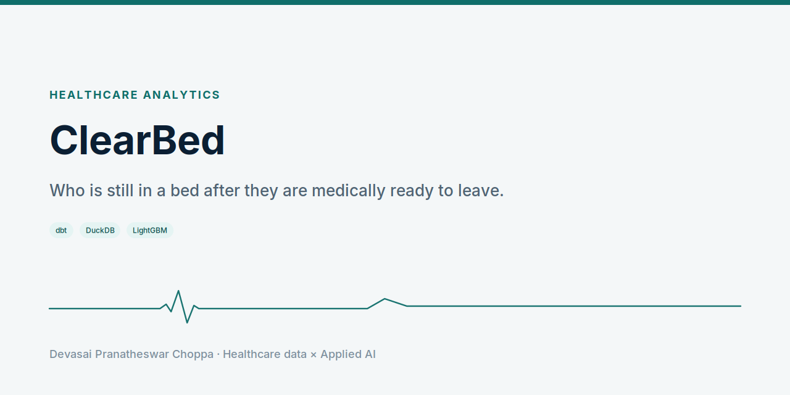
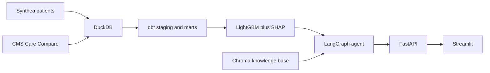

<picture>
  <source media="(prefers-color-scheme: dark)" srcset="docs/social-preview-dark.png">
  
</picture>

**On admission, which inpatients are likely to remain after they are medically ready to leave, and why.**

<p align="center">
  
</p>

[Play the video](docs/walkthrough.mp4). Patients in the demo are synthetic. Facility characteristics come from the CMS Care Compare nursing-home file. This is not a medical device.

## Problem

Hospitals lose staffed beds to patients who are medically ready and have nowhere to go. Placement, coverage, and guardianship work sits in inboxes.

## Solution

ClearBed scores that delay on admission. The barriers it tracks are post-acute placement, payer authorization, guardianship or capacity, and home services. An agent matches synthetic patients to CMS skilled nursing facilities, drafts a referral packet, checks payer rules, and waits for a person to approve anything that would leave the building. The packet is not transmitted.

## Architecture



## Tech stack

Python, DuckDB, dbt, pandas, scikit-learn, LightGBM, SHAP, LangGraph, Chroma, FastAPI, Streamlit, Docker.

## Quickstart

```bash
cp .env.example .env
make setup
make data
make all
make api    # http://localhost:8000/docs
make ui     # http://localhost:8501
```

`make all` includes data, dbt, the quality report, training, scoring, and the knowledge base. After those artifacts exist, `docker compose up` starts the app.

## Results

Models train on Synthea stays with a documented synthetic labeling function. Synthea has no discharge disposition. Metrics describe that label. They are not clinical validation.

Held-out test on the synthetic label, from the repository model card:

| Model | Metric | Value |
| --- | --- | --- |
| Stuck risk | AUROC | 0.716 |
| Stuck risk | AUPRC | 0.592 |
| Stuck risk | Brier | 0.198 |
| Barrier type | macro-F1 | 0.578 |
| Avoidable days | MAE | 2.66 days |

Gender and race are excluded from the model matrix.

## Roadmap

With PhysioNet credentialing, the labeling function can be replaced with MIMIC-IV discharge location and length of stay. That data is not in this repository.

## License

No license file is in the repository yet. Add one before reuse. See the profile checklist.
